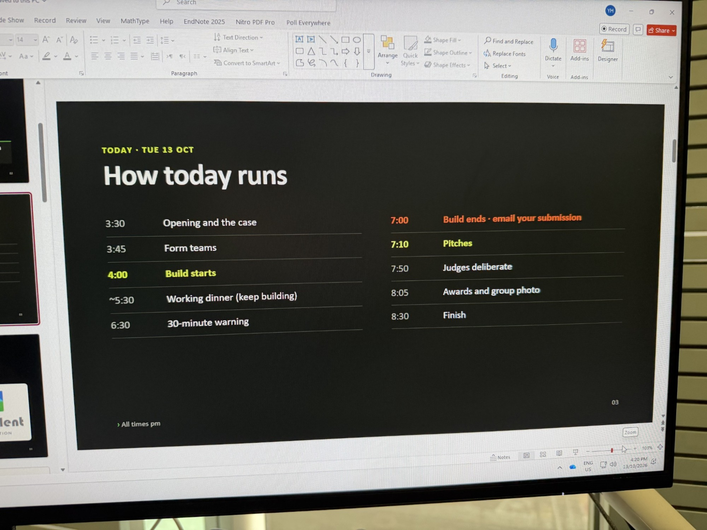

# Case materials

The hackathon's official documents from AI Prototyping Studio, University of Melbourne, kept here so everyone working on or judging ShiftMate reads the same spec.

| File | What it is |
|---|---|
| [AI_Hackathon_Brief_-_Learning_Support_Tutor_Daily_Log_EN.pdf](AI_Hackathon_Brief_-_Learning_Support_Tutor_Daily_Log_EN.pdf) | Case brief: *Automating the Learning Support Tutor's Workday* (6 pages, with Exhibits 1-3) |
| [AIPS_Hackathon_Judging_Rubric.pdf](AIPS_Hackathon_Judging_Rubric.pdf) | Judging rubric: seven weighted criteria out of 100 |
| [event-schedule.jpg](event-schedule.jpg) | Photo of the "How today runs" slide (Tue 13 Oct) |

## Event schedule (Tue 13 Oct, all times pm)

| Time | |
|---|---|
| 3:30 | Opening and the case |
| 3:45 | Form teams |
| **4:00** | **Build starts** |
| ~5:30 | Working dinner (keep building) |
| 6:30 | 30-minute warning |
| **7:00** | **Build ends: email your submission** |
| **7:10** | **Pitches** (3 minutes + 2 minutes Q&A) |
| 7:50 | Judges deliberate |
| 8:05 | Awards and group photo |
| 8:30 | Finish |

## The challenge

> Identify the tasks in this workflow that can be partially automated with AI, and prototype a solution.

- **Role:** Learning Support Tutor at a mathematics tutoring centre, weekday shift 14:00-19:00
- **Tools in use:** Work WeChat, Google Classroom, Google Drive, spreadsheets
- **Records:** Marking Sheet (Exhibit 1), Student Progress Sheet (Exhibit 2), Student Exam Statistics (Exhibit 3)

| Phase | Time | Focus | Steps |
|---|---|---|---|
| 1 | 14:00-14:15 | Start of shift: open systems and records | 1 |
| 2 | 14:15-14:30 | Review timetable, attendance changes, student progress | 2-5 |
| 3 | 14:30-16:00 | WeChat messages; marking and updating Exhibits 1-3 | 6-8 |
| 4 | 16:00-18:00 | Tutoring and Q&A: Scenario A (Module/Demo), B (SAC prep), C (exams) | 9 |
| 5 | 18:20-18:30 | Daily work report and manager sign-off | - |

## Judging rubric

Each criterion is scored 1-5; points = level × (weight ÷ 5). Ties go to the higher Feasibility score, then Impact.

| Criterion | Weight | Excellent (5) looks like |
|---|---|---|
| 1. Problem selection & insight | 15 | Targets specific numbered steps and shows why they are a bottleneck (e.g. the same marking result entered into all three exhibit sheets in step 8). Explains what the tutor still has to do. |
| 2. Creativity | 15 | A fresh angle that makes clever use of what's already recorded, such as using W vs C marks to separate knowledge gaps from careless errors. |
| 3. Feasibility | 20 | Works with tools already in use (Google Sheets, Drive, Classroom, Work WeChat). Realistic costs. A tutor could pilot it within weeks. Main technical risks named, with a fallback. |
| 4. Prototype quality | 20 | Live, working demo on realistic data (modelled on Exhibits 1-3). Handles at least one messy case, like a blank answer or a message in Mandarin. |
| 5. Impact | 15 | Quantified time saved against the 14:00-19:00 shift, with a believable basis. Also shows a benefit to students or parents. |
| 6. Responsible AI | 10 | Tutor keeps the judgement calls (passing a Demo, scheduling a Retest, messages to parents). Handles student data privacy and explains what happens when the AI is wrong. |
| 7. Pitch | 5 | Problem, solution and demo land clearly, on time. Strong answers to judges' questions. |

How ShiftMate answers each criterion: see the rubric map in [../PITCH.md](../PITCH.md#rubric-map-for-us).
